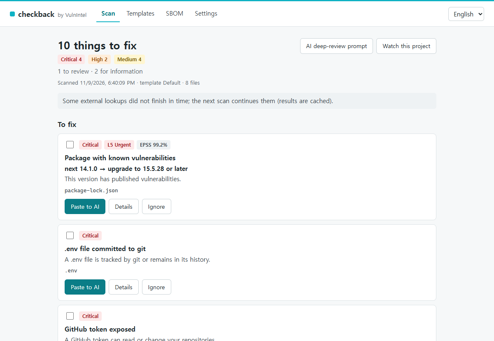
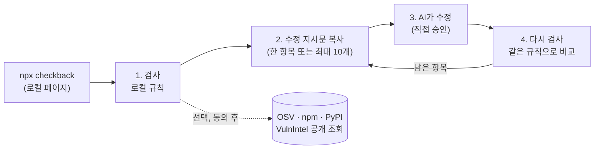
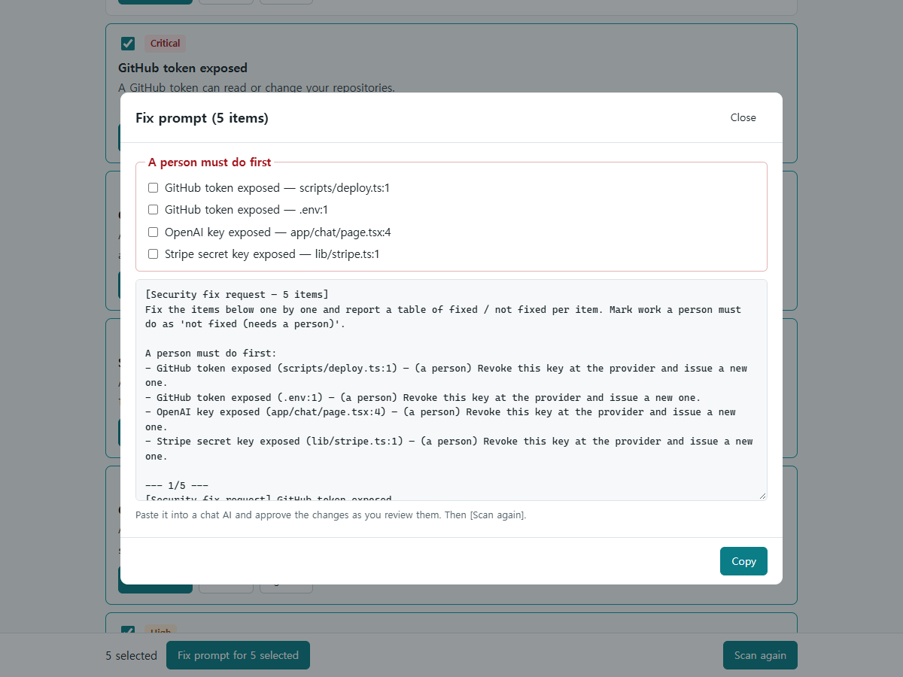
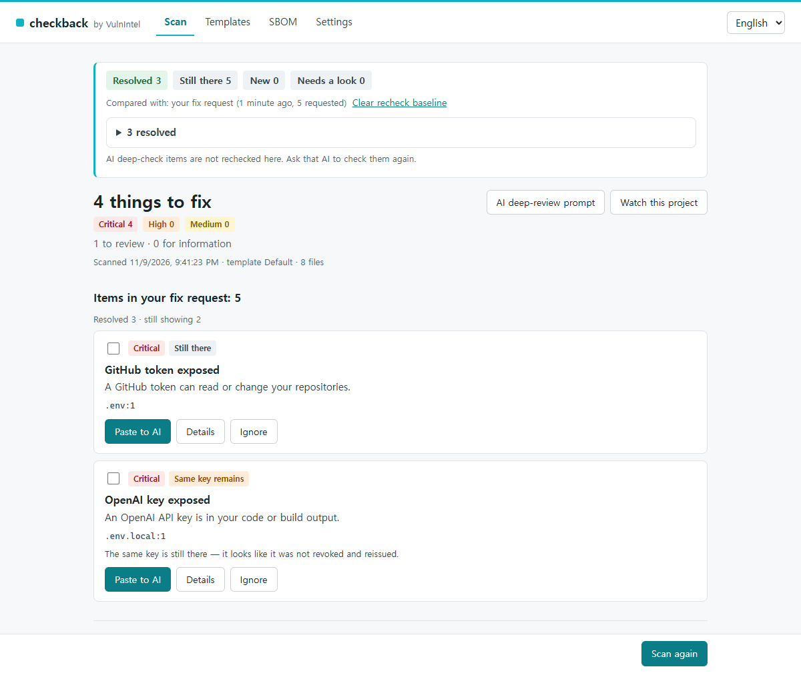

# checkback

[English](https://github.com/vulnintel/checkback/blob/main/README.md) · 한국어 · [简体中文](https://github.com/vulnintel/checkback/blob/main/README.zh-CN.md)

**AI 코딩 도구가 남긴 보안 실수를 찾고, 수정은 쓰던 AI에게 넘긴 뒤, 다시 검사합니다.**

[](https://github.com/vulnintel/checkback/actions/workflows/ci.yml)
[](https://www.npmjs.com/package/checkback)
[](package.json)
[](LICENSE)

checkback은 Cursor, Claude Code, Lovable, Bolt 같은 AI 코딩 도구로 만든 앱에서 흔히 생기는 보안
실수를 내 컴퓨터에서 검사합니다. 브라우저 코드에 들어간 비밀키, 커밋된 `.env`, RLS가 없는 Supabase
테이블, `if true`로 열어 둔 Firebase 규칙, 모든 출처를 허용하는 CORS, 운영 환경의 디버그 모드, 취약하거나
AI가 지어낸 패키지 같은 것들입니다. 발견 항목마다 쉬운 말로 쓴 수정 지시문이 나오고, 이것을 지금 쓰는
AI에 붙여넣으면 됩니다. 수정이 끝나면 다시 실행하세요. checkback이 규칙으로 아는 항목(비밀키, 설정,
의존성 버전)을 다시 확인하고 아직 남아 있는 것을 보여 줍니다.

코드는 내 컴퓨터 밖으로 나가지 않습니다. 계정도 필요 없습니다.



<sub>가짜 키를 넣은 데모 프로젝트입니다. 취약점 데이터는 OSV.dev, 우선순위는 VulnIntel에서 가져왔습니다.</sub>

## 빠르게 시작하기

프로젝트 폴더에서 실행하세요(Node.js 20.18 이상).

```sh
npx checkback
```

1. 브라우저에 로컬 페이지가 열립니다. 외부 조회에 동의하세요(거절해도 로컬 규칙은 실행됩니다).
2. **검사 시작**을 누릅니다.
3. 고칠 항목을 체크하고(또는 **빠른 선택**: 긴급, 긴급+높음, 전체) **선택한 n개 수정 지시문**을 누른 뒤,
   복사해서 AI에 붙여넣습니다.
4. AI가 수정을 마치면 **다시 검사**를 누릅니다.

화면과 터미널 보고서는 English, 한국어, 简体中文으로 볼 수 있습니다.

검사는 외부 조회를 최대 90초까지 기다린 뒤 그때까지 받은 결과를 보여 주고, 아직 기다리는 항목이 무엇인지
알려 줍니다. 다음 검사는 캐시에서 이어 갑니다. 공개 우선순위 조회(KEV, VPI, EPSS)는 1분에 취약점 약
50개를 처리하므로, 알려진 취약점이 수백 개인 프로젝트는 우선순위 배지가 모두 채워지기까지 3~4번 검사해야
합니다. 그 전까지 해당 패키지는 OSV/CVSS 심각도를 그대로 씁니다.

의존성 검사는 `package-lock.json`, `pnpm-lock.yaml`, `uv.lock`, `requirements*.txt`를 읽습니다.
`bun.lock`만 있는 프로젝트(Lovable 기본값)도 다른 검사는 모두 받지만, 의존성은 아직 검사하지 못합니다.
같은 폴더에 `uv.lock`과 `requirements*.txt`가 함께 있으면 같은 버전의 패키지는 `uv.lock`을 가리키는 발견
항목 하나로 합칩니다.

터미널이나 Claude Code 안에서 쓰고 싶다면 [Claude Code 플러그인](#claude-code-플러그인),
[MCP 서버](#mcp-서버), [명령줄](#명령줄)을 보세요.

## 왜 checkback인가

AI 코딩 도구는 앱을 잘 만들고, 리뷰도 대체로 잘합니다. 하지만 반복 작업에서는 덜 믿음직합니다. git 이력
읽기, 정확한 패키지 버전을 보안 권고와 맞춰 보기, 같은 질문에 매번 같은 답 내기 같은 일입니다. Gitleaks와
osv-scanner는 각자 맡은 일(비밀키, 의존성 버전)은 잘하지만 Supabase 마이그레이션이나 Firebase 규칙은 읽지
않습니다. checkback은 그 사이를 메웁니다. AI를 대신하는 도구가 아니라 AI와 함께 쓰는 도구입니다.

Supabase를 쓴다면 Supabase Security Advisor도 함께 돌리세요. Security Advisor는 실제 데이터베이스를
검사하고, checkback은 코드와 마이그레이션을 읽습니다.

| | checkback | Gitleaks | osv-scanner | AI 코드 리뷰만 |
|---|---|---|---|---|
| 코드와 빌드 결과물 속 비밀키 | 예 | 예 | 아니요 | 예 |
| 공개 키(Supabase anon, Firebase 웹 설정)는 문제 삼지 않음 | 예 | 자주 걸림 | 해당 없음 | 측정 안 함 |
| git 이력에 남은 `.env`와 키 파일 | 예 | 예 | 아니요 | 읽기 전용 도구로는 못 함 |
| Supabase RLS, Firebase 규칙, CORS, 디버그 설정 | 예 | 아니요 | 아니요 | 예 |
| lock 파일 기준 취약 버전 | 예 (OSV) | 아니요 | 예 | 일부. 한 버전을 잘못 판단 |
| 존재하지 않는 패키지 이름(AI가 지어냄) | 예 | 아니요 | 아니요 | 측정 안 함 |
| 권한 검사, IDOR, 인젝션, 비즈니스 로직 | AI용 체크리스트만 | 아니요 | 아니요 | 예 |
| 로컬 규칙: 같은 입력이면 같은 결과(외부 조회는 실시간 데이터에 따라 달라짐) | 예 | 예 | 해당 없음(조회만 함) | 아니요 |
| 실행할 때마다 드는 비용 없음 | 예 | 예 | 예 | 아니요 |
| 비전문가가 AI에 그대로 붙여넣을 수 있게 쓴 수정 지시문 | 예 | 아니요 | 아니요(`osv-scanner fix`가 일부 의존성은 직접 올릴 수 있음) | 예 |
| 수정을 요청한 시점과 비교하는 재검사 | 예 | 다시 실행 | 다시 실행 | 다시 질문 |

어떻게 확인했나: 2026년 11월, 공개된 AI 제작 저장소 5곳을 각각 고정된 커밋에서 이 도구들로 검사했습니다.

- checkback 0.1.0 배포 패키지. VulnIntel 키 없이, 외부 조회는 허용했습니다.
- Gitleaks 8.30.1과 osv-scanner 2.7.0, 기본 설정. osv-scanner는 checkback과 같은 날 다시 돌렸고,
  Gitleaks 수치는 일주일 전 1차 실행 결과입니다.
- AI 리뷰: Claude Code 2.1.316, 읽기 전용 도구(Read/Grep/Glob, 셸 없음), 자체 리뷰 프롬프트, 저장소마다
  1회 실행(1차).

결과:

- AI 리뷰가 가장 넓은 범위의 문제를 다뤘습니다. checkback이 다루는 분야인데 checkback이 아직 놓치는
  문제도 일부 있었습니다. 하드코딩된 관리자 비밀번호, Firestore 규칙 로직 같은 것입니다. 5곳 중 3곳에서는
  git 이력을 보지 않았다고 스스로 밝혔습니다. 취약한 의존성 버전 하나를 "패치됨"이라고 판단했습니다.
  리뷰 한 번에 24~47턴, 87~178초, $0.50~$1.40가 들었습니다.
- 같은 날 실행한 checkback과 osv-scanner는 checkback이 읽는 lock 파일에서 취약한 의존성 버전 202개 중
  202개가 일치했습니다.
- 작업 트리에는 공개 키 5개가 있었습니다. 한 앱의 Supabase anon 키 3개, 다른 앱의 커밋된 빌드 결과물에
  든 Clerk publishable 키 1개와 PostHog 키 1개입니다. checkback은 이 중 어느 것도 비밀키로 보고하지
  않았고, Supabase 키는 브라우저에 둬도 안전하다고 표시했습니다. Gitleaks는 git 이력 속 사본까지 세어
  공개 키를 11번 보고했습니다. 진짜 비밀값 하나, `.mcp.json`에 든 Supabase access token은 둘 다
  보고했습니다.
- 한 앱은 공개값만 든 `.env`를 커밋해 두었습니다. checkback은 키를 교체하라고 하지 않고 참고 항목으로
  표시했습니다.
- 다른 도구는 하나도 찾지 못하고 checkback만 보고한 문제가 하나 있었습니다. 스트리밍 응답에 하드코딩된
  `Access-Control-Allow-Origin: *`입니다.

표본이 작으니 벤치마크가 아니라 방향을 보여 주는 결과로 읽어 주세요.

## 동작 방식



**수정 지시문**은 사람만 할 수 있는 일(유출된 키 폐기·재발급)을 먼저 적고, 이어서 발견 항목마다
`file:line`, 무엇이 문제인지, 어떻게 고치는지를 한 섹션씩 담습니다. 비밀값은 절대 넣지 않고, 프로젝트에
없는 패키지를 설치하라고 AI에게 시키지도 않습니다.



**다시 검사**는 수정 지시문을 복사한 시점과 비교합니다. 아래 데모에서는 OpenAI 키를 폐기하지 않고
`.env.local`로 옮기기만 해서, checkback이 같은 키로 보고합니다.

<picture>
  
</picture>

## 하는 일과 하지 않는 일

| 하는 일 | 하지 않는 일 |
|---|---|
| 코드, 설정, 빌드 결과물에서 비밀키(OpenAI, Anthropic, Supabase, AWS, Stripe, GitHub, 개인 키, DB URL, …)를 찾습니다 | 앱이 안전하다는 증명. 통과는 이 규칙들에 걸린 것이 없다는 뜻일 뿐입니다 |
| git을 검사합니다: 추적 중이거나 이력에 남은 `.env`와 키 파일, `.env` 규칙이 없는 `.gitignore` | 권한 검사, IDOR, 인젝션 등 앱 로직 검사. 대신 AI용 리뷰 체크리스트를 써 주며, AI의 답은 다시 검사하지 않습니다 |
| Supabase 마이그레이션(RLS 없는 테이블, 항상 참인 정책)과 Firebase 규칙을 읽습니다 | Supabase·Firebase 프로젝트나 데이터베이스 접속 |
| 와일드카드 CORS, 디버그 모드, 공개된 소스맵을 찾습니다 | 웹사이트 스캔이나 네트워크 너머의 검사 |
| `package-lock.json`, `pnpm-lock.yaml`, `uv.lock`, `requirements*.txt`를 읽고, (동의 후) 취약·악성·존재하지 않는 패키지를 조회합니다 | yarn, bun, poetry, Pipfile lock 파싱(아직 못 합니다. "문제 없음" 대신 "아직 지원하지 않음"이라고 알립니다) |
| CycloneDX SBOM을 로컬에서 만듭니다 | 코드를 어디로든 업로드 |
| 수정 후 자기가 찾은 항목을 다시 검사합니다 | 코드 수정, AI를 스스로 실행 |

## Claude Code 플러그인

checkback은 Claude Code용 플러그인을 함께 제공합니다. Claude Code에서 마켓플레이스를 추가하고 플러그인을
설치하세요.

```text
/plugin marketplace add vulnintel/checkback
/plugin install checkback@vulnintel
```

그다음 "보안 점검해줘"(또는 "run a security check")라고 요청하세요. Claude가 checkback의 `scan`을
호출해 발견 항목을 보여 줍니다. 원하면 checkback 체크리스트로 코드를 리뷰하고, 그 결과는 "AI 판단"으로
따로 보고합니다. 수정을 요청하면 모든 편집은 Claude Code의 평소 승인 절차를 거칩니다. 그 뒤 `scan`을 다시
호출해, checkback이 알려 주는 항목별 재검사 상태를 그대로 보고합니다.

플러그인은 파일 3개이며 모두 [`plugin/`](plugin)에 있습니다.

| 파일 | 용도 |
|---|---|
| `.claude-plugin/plugin.json` | 플러그인 이름과 버전 |
| `skills/checkback/SKILL.md` | Claude가 따르는 지시: 검사, 선택적인 AI 리뷰, 사용자 승인을 받은 수정, 다시 검사 |
| `.mcp.json` | 플러그인 버전에 고정한 `npx -y checkback@<version> mcp`를 키 없이 실행 |

hook, 바이너리, 에이전트, 커맨드, 권한 규칙, 자동 승인 설정은 없습니다. 마켓플레이스 매니페스트는
[`.claude-plugin/marketplace.json`](.claude-plugin/marketplace.json)입니다.

플러그인은 사용자 권한으로 실행됩니다. 이 마켓플레이스를 포함해 어떤 서드파티 마켓플레이스든 추가하기 전에
파일을 읽어 보고, 믿을 수 있는 출처의 플러그인만 설치하세요.

VulnIntel 키 연결, 패키지 감시, 발견 항목 무시는 채팅이 아니라 `npx checkback`에서 합니다.

처음 쓸 때 `/mcp`에서 checkback 서버 연결 실패가 보이면, npx가 아직 패키지를 내려받던 중입니다.
터미널에서 `npx -y checkback@<version> --version`을 한 번 실행해 npx 캐시를 채운 뒤 Claude Code를 다시
시작하세요. 느린 컴퓨터에서는 Claude Code의 MCP 시작 제한 시간을 늘려도 됩니다. 예:
`MCP_TIMEOUT=120000`.

## MCP 서버

MCP 클라이언트라면 어디서든 stdio로 같은 엔진을 쓸 수 있습니다. 버전을 고정하세요.

```json
{
  "mcpServers": {
    "checkback": {
      "command": "npx",
      "args": ["-y", "checkback@0.1.0", "mcp"]
    }
  }
}
```

플러그인 없이 Claude Code에서 쓰려면 `claude mcp add checkback -- npx -y checkback@0.1.0 mcp`를
실행하세요. Windows 네이티브 환경의 일부 클라이언트는 `"command": "cmd"`와
`"args": ["/c", "npx", "-y", "checkback@0.1.0", "mcp"]`가 필요합니다.

서버는 자신이 시작된 폴더를 검사합니다(Claude Code는 `CLAUDE_PROJECT_DIR`로 프로젝트 폴더를 넘깁니다).
경로를 받는 도구는 없습니다.

| 도구 | 반환값 |
|---|---|
| `scan(template?)` | `{findings, checked, compare?, notice?}`. 수정 요청 뒤에는 `compare`(개수와 해결된 항목)와 각 발견 항목의 `recheck`에 비교 결과가 담깁니다 |
| `explain(finding_id)` | 이 발견 항목이 왜 중요한지, 어떻게 고치는지 |
| `fix_prompts(finding_ids)` | 발견 항목 최대 10개의 수정 지시문. 수정 요청 기준점을 기록합니다 |
| `ai_check_prompt()` | AI용 읽기 전용 리뷰 체크리스트(권한 검사, IDOR, 인젝션, …) |
| `export_sbom()` | lock 파일에 고정된 의존성의 CycloneDX JSON |

MCP 응답에는 비밀값, 가린 값, 파일 내용이 절대 들어가지 않고 비밀의 종류와 `file:line`만 들어갑니다.
발견 항목 무시, 동의, 패키지 감시, AI 실행을 하는 도구는 없습니다. 동의하기 전에는 `scan`이 로컬 규칙만
실행하고, `notice`에 조회를 켜는 방법을 알려 줍니다.

MCP 설정 파일에는 절대 VulnIntel 키를 넣지 마세요. `VULNINTEL_API_KEY` 환경 변수나 설정 페이지를 쓰세요.

## 명령줄

| 명령 | 하는 일 |
|---|---|
| `checkback` / `checkback gui` | 로컬 페이지를 시작하고 브라우저를 엽니다 |
| `checkback --no-open` | 위와 같지만 URL만 출력합니다 |
| `checkback scan [--lang en\|ko\|zh] [--template file.yaml] [--json\|--text] [--fail-on severity]` | 현재 폴더를 검사합니다. 터미널에서는 읽기 쉬운 보고서(심각도별 요약, 발견 항목마다 file:line과 한 줄 설명)를, 파이프나 CI에서는 JSON을 출력합니다. `--json` / `--text`로 둘 중 하나를 강제할 수 있습니다. 키 값이나 가린 값은 절대 출력하지 않습니다 |
| `checkback sbom [--upload-preview]` | lock 파일에 고정된 의존성의 CycloneDX JSON SBOM을 출력합니다. `--upload-preview`는 VulnIntel 키로 보낼 형태(비공개 패키지 제외)를 출력만 하고 아무것도 업로드하지 않습니다. `--upload`는 예전 별칭입니다 |
| `checkback mcp` | stdio로 MCP 서버를 실행합니다 |
| `checkback consent` | 터미널에서 외부 조회에 동의합니다. 대화형 터미널 전용 |
| `checkback ignore [--remove]` | 마지막 검사의 발견 항목을 (이유와 함께) 무시하거나 무시를 해제합니다. 대화형 터미널 전용 |
| `checkback watch` | VulnIntel 키 필요: lock 파일에 고정된 공개 패키지에 새 취약점이 생기는지 감시합니다. 대화형 터미널 전용 |
| `checkback track` | VulnIntel 키 필요: 마지막 검사의 CVE를 VulnIntel 조치 대장에 추가합니다. 대화형 터미널 전용 |

`checkback --help`는 모든 명령과 옵션을, `checkback --version`은 버전을 출력합니다.

로컬 페이지는 `127.0.0.1`에만 바인딩되고 실행할 때마다 새 무작위 토큰을 씁니다. Ctrl+C를 누르거나 마지막
탭을 닫고 30분이 지나면 멈춥니다.

종료 코드: `0` 완료(발견 항목 유무와 상관없음), `1` `--fail-on` 기준에 도달했거나 명령 실패, `2` 알 수
없는 명령이나 옵션.

### CI에서

`scan --fail-on <critical|high|medium|low>`는 해당 심각도 이상인 확정 발견 항목("고칠 일")이 있으면 1로
종료합니다(`low` = 모든 심각도). 확인 필요·참고 항목은 빌드를 실패시키지 않습니다.

```yaml
# .github/workflows/checkback.yml
on: [push, pull_request]
jobs:
  checkback:
    runs-on: ubuntu-latest
    steps:
      - uses: actions/checkout@v4
        with:
          fetch-depth: 0 # 커밋된 .env / 키 파일 규칙이 git 이력을 볼 수 있게 함
      - uses: actions/setup-node@v4
        with:
          node-version: 22
      - run: npx -y checkback@0.1.0 scan --text --fail-on high
```

CI에서는 의존성 조회 없이 로컬 규칙만 실행합니다. 동의는 사람만 할 수 있고(`checkback consent`는 대화형
터미널이 필요하며, 로컬 페이지에서도 할 수 있습니다), 새로 뜬 CI 러너에는 저장된 동의가 없기 때문입니다.
보고서 맨 위에 이 사실이 적히고, `--fail-on`은 의존성 검사를 실행하지 않았다는 경고를 stderr에 출력합니다.
종료 코드는 실행된 검사만 반영합니다. shallow clone이면 git 이력 검사를 일부 건너뛰었다는 내용도 보고서에
나옵니다.

설정, 동의, 무시 목록, 재검사 기준점은 프로젝트 밖에 저장됩니다. Windows는 `%APPDATA%\checkback`,
macOS는 `~/Library/Application Support/checkback`, Linux는 `$XDG_DATA_HOME/checkback`(기본값
`~/.local/share/checkback`)입니다.

## 규칙

기본 템플릿([`templates/default.yaml`](templates/default.yaml))은 읽기 전용이며 엔진과 함께 버전이
매겨집니다.

| 분류 | 규칙 | 예시 |
|---|---|---|
| 비밀키 | `secret-openai`, `secret-anthropic`, `secret-supabase-service-role`, `secret-supabase-pat`, `secret-aws`, `secret-stripe-live`, `secret-github`, `secret-google-key`, `secret-private-key`, `secret-db-url`, `secret-vulnintel`, `secret-public-env-prefix`, `secret-in-mcp-config` | 브라우저 코드나 빌드 결과물에 든 키, `NEXT_PUBLIC_`이나 `VITE_`를 붙인 비밀값 |
| 커밋된 파일 | `env-committed`, `key-file-committed`, `gitignore-env-missing` | 추적 중이거나 git 이력에 남은 `.env`, 커밋된 `*.pem` |
| 백엔드 규칙 | `supabase-rls`, `firebase-rules` | RLS 없이 만든 테이블, `allow read, write: if true` |
| CORS | `cors-wildcard`, `cors-credentials-any` | `app.use(cors())`, 자격 증명과 함께 모든 출처 허용 |
| 디버그 | `debug-django`, `debug-flask`, `debug-fastapi`, `debug-laravel`, `debug-spring`, `debug-env-production` | 운영 설정의 `DEBUG = True` |
| 소스맵 | `sourcemap-next`, `sourcemap-vite`, `sourcemap-in-build` | 운영 소스맵이 공개적으로 제공됨 |
| 의존성(조회) | `vulnerable-deps`, `hallucinated-package` | 알려진 취약 버전(OSV), 악성 패키지(OpenSSF), npm이나 PyPI에 없는 이름 또는 인기 패키지의 오타처럼 보이는 이름 |
| AI 체크리스트 | `ai-*` 항목 11개 | 권한 검사, IDOR, 인젝션, 서버 측 검증, … AI에게 체크리스트로만 보내며, checkback이 직접 실행하거나 다시 검사하지 않습니다 |

발견 항목마다 심각도(`critical`, `high`, `medium`)와 확신도가 있습니다. 확신도는 **확정**(고칠 일로 셈),
**확인 필요**(직접 봐야 함), **참고**(접혀 있음) 중 하나입니다. 예시와 문서(`.env.example`, README 코드
블록)는 참고, 테스트 폴더는 확인 필요로 분류하고, 자리표시 값(`your-key`, `xxx`, `<…>`, `changeme`)은
보고하지 않습니다. gitignore 되어 추적되지 않고 한 번도 커밋된 적 없는 `.env.local`은 키를 두는 정상
위치이므로 참고입니다.

## 재검사 상태

기준점은 수정 지시문을 복사한(또는 `fix_prompts`를 호출한) 시점입니다. 기준점이 없으면 직전 검사와
비교합니다. AI 판단은 비교 대상이 아닙니다.

| 상태 | 뜻 |
|---|---|
| 해결됨 | 발견 항목이 사라졌습니다. 키라면 발급처에서 키를 폐기하고 새로 발급하는 일도 잊지 마세요 |
| 아직 남음 | 발견 항목이 그대로 있습니다. 취약한 패키지를 올렸는데 올린 버전도 취약하면 카드 하나로 남고 "4.17.20 → 4.17.21로 올렸지만 아직 취약합니다. 4.18.0 이상으로 올리세요." 같은 메모가 붙습니다. 매니페스트는 바뀌었는데 lock 파일이 그대로면, 다시 설치해 lock을 새로 만들라는 메모가 붙습니다 |
| 새로 생김 | 기준점에 없던 발견 항목입니다 |
| 같은 키 남음 | 같은 키 값이 아직 어딘가에 있습니다. 예를 들어 `.env.local`로 옮긴 경우입니다. 폐기·재발급하지 않은 것으로 보입니다 |
| 옮겨짐 의심 | 같은 내용이 다른 파일로 옮겨진 것 같습니다 |
| 확신도 낮아짐 | 규칙이 덜 엄격하게 보는 위치(예: 테스트 폴더)로 옮겨졌습니다. 원래 확신도는 그대로 유지합니다 |
| 확인 필요(lock) | lock 파일을 손으로 고친 것 같습니다. 새 integrity 해시 없이 버전이 바뀌었거나, 매니페스트에 없는 최상위 항목이 있습니다. 패키지 매니저로 다시 설치하세요 |
| 검사 안 함 | 이번에는 규칙이 실행되지 않아(꺼져 있거나 오프라인) 결과를 알 수 없습니다 |

## 무엇이 어디로 가나

checkback 자체는 어떤 서버에도 코드나 파일 경로를 보내지 않습니다. 다만 AI에 붙여넣는 지시문에는
`file:line`이 들어갑니다(아래 표 마지막 줄). 외부 조회는 동의한 뒤에만 실행되며, 조회마다 설정에서 끌 수
있습니다.

| 보내는 곳 | 언제 | 보내는 내용 | 절대 보내지 않는 것 |
|---|---|---|---|
| `api.osv.dev` | 취약·악성 패키지 검사 | 조회 범위에 든 패키지의 생태계, 이름, 버전 | 코드, 파일 경로, 비공개 패키지 이름 |
| `registry.npmjs.org`, `api.npmjs.org`, `pypi.org` | 존재하지 않는 패키지 검사 | 조회 범위에 든 패키지 이름(lock에 없는 매니페스트 이름과 걸러 낸 import 이름 포함) | 위와 같음 |
| `api.vulnintelapp.com` (공개 조회, 키 없음) | 우선순위(KEV, VPI 등급, EPSS)와 설명 | OSV 결과의 CVE/GHSA ID와 화면 언어. IP와 ID 목록이 접근 로그(VulnIntel 서버와 그 앞단의 Cloudflare)에 남을 수 있고, ID 목록으로 어떤 취약 컴포넌트를 쓰는지 짐작할 수 있습니다 | 패키지 이름과 버전, 코드, 경로 |
| `api.vulnintelapp.com` (키 사용) | VulnIntel 키를 추가한 경우에만 | 로컬에서 만든 공개 패키지의 CycloneDX SBOM(이름, 버전, purl, 라이선스. 프로젝트 이름 없음), 조치 대장에 추가할 때 CVE ID와 `checkback: <package>@<version>` 메모, 감시하기로 고른 패키지의 생태계와 이름(버전 없음) | 코드, 경로, lock 파일 이름, 비공개 패키지 |
| 사용하는 AI | 지시문을 붙여넣을 때, 또는 AI가 MCP 도구를 호출할 때 | 지시문과 MCP 응답: 규칙, 심각도, 확신도, `file:line`, 패키지, 버전, 취약점 ID. `export_sbom`은 로컬 SBOM을 돌려주는데, 여기에는 비공개 패키지와 lock 파일 경로가 들어 있습니다. AI 도구가 파일을 직접 읽을 수도 있으며, 이는 사용자와 AI 제공업체 사이의 일입니다 | 비밀값과 가린 값. 이 경로로는 VulnIntel에 아무것도 가지 않습니다 |

비공개 레지스트리(`.npmrc`의 scoped 레지스트리나 기본 레지스트리 변경, `--extra-index-url`), 워크스페이스,
파일, git URL에서 오는 패키지는 조회 범위에서 빠집니다.

키를 쓰면 VulnIntel은 검사 결과와 SBOM을 30일, 업로드된 원본을 35분 동안 보관합니다. 감시 중인 패키지와
조치 항목은 웹에서 지울 때까지 남습니다.

키 유무와 상관없이 `api.vulnintelapp.com`으로 가는 모든 요청은 Cloudflare(VulnIntel의 CDN 겸 방화벽)를
거치며, Cloudflare는 IP와 요청 내용을 봅니다.

요청에는 `User-Agent: checkback/<version> (+https://github.com/vulnintel/checkback)`가 붙습니다.
텔레메트리는 없습니다.

## VulnIntel 키(선택)

위 기능은 모두 계정 없이 동작합니다. 무료 [VulnIntel](https://www.vulnintelapp.com) 키를 연결하면 두 가지가
더해집니다.

- **계속 감시**: 고른 패키지에 새 취약점이 생기면 알림을 받고(페이지의 **이 프로젝트 감시 켜기** 또는
  `checkback watch`), CVE를 웹 조치 대장에 추가할 수 있습니다.
- **기록**: 검사 결과를 웹에 30일 동안 보관합니다.

<https://www.vulnintelapp.com/en/settings/api-keys?src=checkback>에서 키를 받아 설정 페이지에 붙여넣거나
`VULNINTEL_API_KEY`를 설정하세요(환경 변수가 우선합니다). macOS와 Linux에서는 설정 파일을 mode 600으로
씁니다. 키는 `api.vulnintelapp.com` 말고는 어디에도 보내지 않습니다.

무료 키에는 매달 VulnIntel 조회 100회가 포함됩니다. 다 쓰면 매달 초기화될 때까지 검사에 OSV 결과만
나옵니다.

## 템플릿과 무시

**템플릿** 페이지에서 기본 템플릿을 복제하고, 규칙을 켜고 끄고, AI 체크리스트 문장을 직접 추가하고,
템플릿을 YAML로 내보내거나 가져올 수 있습니다. 가져온 템플릿의 문구는 "외부"로 표시되고, 복사하기 전에
전문을 보여 줍니다.

직접 작성한 템플릿에는 `pattern` 규칙을 추가할 수 있습니다.

```yaml
schema: 1
id: my-rules
name: My rules
rules:
  - id: internal-admin-token
    name: { en: Internal admin token in code, ko: 내부 관리자 토큰 노출 }
    type: pattern
    severity: high
    files: ['src/**/*.ts']
    match:
      - 'ADMIN_TOKEN\s*=\s*"[A-Za-z0-9]{24,}"'
    description:
      en: An internal admin token is hard-coded.
      ko: 내부 관리자 토큰이 코드에 들어 있습니다.
    fix_prompt:
      en: Remove the token from {file} and read it from a server-side environment variable.
      ko: "{file}에서 토큰을 지우고 서버 환경변수에서 읽게 바꾸세요."
```

```sh
npx checkback scan --template my-rules.yaml
```

템플릿은 불러올 때 검증합니다. 알 수 없는 필드, 프로젝트 밖을 가리키는 glob, 느린 정규식, 1MB가 넘는
파일은 거부합니다.

발견 항목을 무시하면(페이지의 **무시** 또는 `checkback ignore`) 그 지문(fingerprint), 라벨(규칙 제목,
패키지, `file:line`), 입력한 이유가 프로젝트가 아니라 설정 폴더에 저장됩니다. 무시한 항목은 줄 위치가
바뀌어도, MCP 결과와 재검사에서도, 설정에서 해제하기 전까지 계속 숨겨집니다.

## FAQ

**코드가 내 컴퓨터 밖으로 나가나요?**
아니요. 밖으로 나가는 것은 [무엇이 어디로 가나](#무엇이-어디로-가나)에 적힌 패키지 이름, 버전, 취약점
ID뿐이고, 그것도 동의한 뒤에만 나갑니다. 거절하면 아무것도 보내지 않습니다.

**오프라인에서도 되나요?**
네. 로컬 규칙, SBOM, 수정 지시문, 재검사는 네트워크 없이 동작합니다. 조회 규칙은 실패하는 대신 "검사 안
함(오프라인)"으로 표시됩니다. 릴리스 테스트에서는 설치한 패키지를 네트워크를 끈 컨테이너에서 실행합니다.

**문제없는 것을 보고했어요. 어떻게 하나요?**
**무시**를 누르고 이유를 적거나, [오탐 신고](https://github.com/vulnintel/checkback/issues/new?template=false_positive.yml)를
여세요. 실제 값은 절대 붙여넣지 말고 형태만 설명하세요. 원래 공개용인 키(Supabase anon 또는 publishable
키, Firebase 웹 설정, Stripe publishable 키)는 비밀키로 보고하지 않습니다.

**검사 결과가 깨끗해요. 안전한가요?**
꼭 그렇지는 않습니다. 깨끗한 결과는 이 규칙들에 걸린 것이 없다는 뜻입니다. checkback은 앱 로직을 검사하지
않습니다. 그 부분은 AI 체크리스트를 쓰고, 그 답은 AI의 판단으로 받아들이세요.

**checkback이 코드를 고치거나 AI를 실행하나요?**
아니요. 지시문만 씁니다. 어떤 AI로 적용할지는 사용자가 고르고, 변경 승인도 그 AI에서 합니다.

**어떤 AI 도구와 함께 쓸 수 있나요?**
글을 붙여넣을 수 있는 도구라면 무엇이든 됩니다. Claude Code는 플러그인도 쓸 수 있고, MCP 클라이언트라면
MCP 서버를 쓸 수 있습니다.

**왜 git이 필요한가요?**
커밋되었거나 이력에 남은 `.env`와 키 파일을 찾기 위해서입니다. git이 없으면 그 두 검사를 건너뛰고, 건너뛰었다고
알려 줍니다.

## 개발

```sh
corepack enable          # pnpm 버전은 package.json에서 가져옴
pnpm install
pnpm build               # 엔진 → dist/, 웹 페이지 → dist/web/
pnpm test                # 단위·통합 테스트, 네트워크 없음
node dist/cli.js --no-open
```

`pnpm e2e:docker`는 `npm pack`으로 패키지를 묶고, 깨끗한 `node:20-slim`, `node:22-slim`, `node:24-slim`
컨테이너에 tarball을 설치한 뒤 CLI, MCP 서버, 로컬 페이지를 확인합니다. 네트워크가 있을 때 한 번,
`--network none`으로 한 번 실행합니다([`docker/e2e/`](docker/e2e)). Docker와 bash가 필요합니다.

`node scripts/live-smoke.mjs`는 실제 OSV, npm, PyPI, VulnIntel 조회를 수동으로 실행합니다. `pnpm test`에는
포함되지 않습니다.

풀 리퀘스트를 열기 전에 [CONTRIBUTING.md](CONTRIBUTING.md)를 읽어 주세요. 변경 내역은
[CHANGELOG.md](CHANGELOG.md)에 있습니다.

## 보안

checkback의 취약점은 비공개로 제보해 주세요. [SECURITY.md](SECURITY.md)를 참고하세요.

## 상표

Claude and Claude Code are trademarks of Anthropic, PBC. This project is not affiliated with or
endorsed by Anthropic. Other product names are trademarks of their owners and are used only to
describe compatibility.

## 라이선스

[Apache-2.0](LICENSE). 서드파티 코드와 데이터는 [NOTICE](NOTICE)에 정리되어 있습니다.
취약점 데이터: [OSV.dev](https://osv.dev)(출처별 라이선스, 악성 패키지:
[OpenSSF Malicious Packages](https://github.com/ossf/malicious-packages)). 우선순위 데이터: VulnIntel
(KEV: CISA, EPSS: FIRST.org).

만든 곳: [VulnIntel](https://www.vulnintelapp.com).
