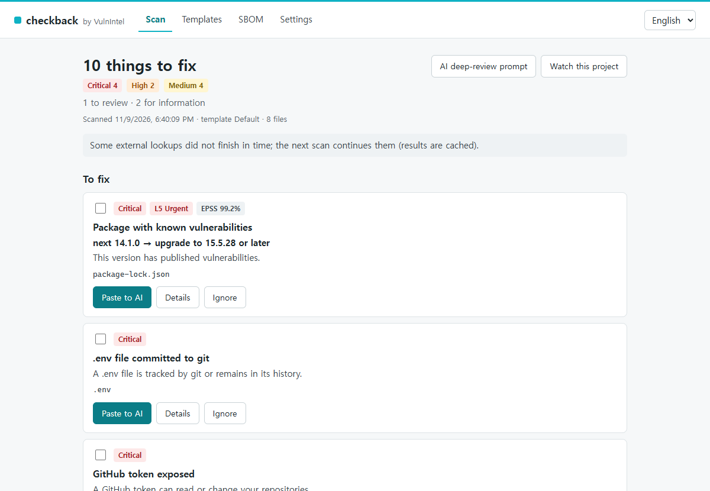
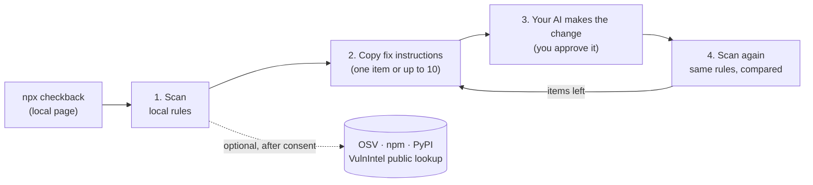
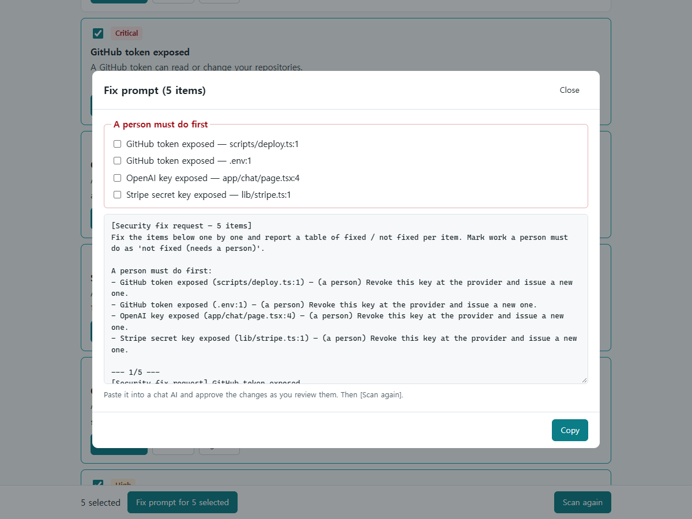
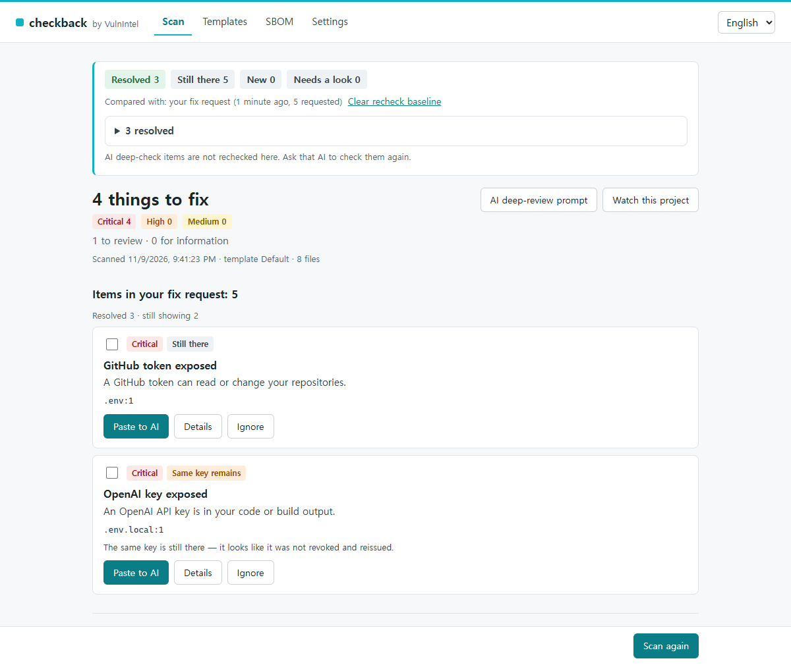

# checkback

**Find the security mistakes AI coding tools leave behind, hand the fixes back to your AI, then check again.**

[](https://github.com/vulnintel/checkback/actions/workflows/ci.yml)
[](https://www.npmjs.com/package/checkback)
[](package.json)
[](LICENSE)

checkback scans your project on your machine for common security mistakes in apps built with AI
coding tools such as Cursor, Claude Code, Lovable and Bolt: secret keys in browser code, a committed
`.env`, Supabase tables without RLS, Firebase rules that say `if true`, wide-open CORS, debug mode in
production, and vulnerable or AI-invented packages. Each finding becomes a plain-language fix
instruction you paste into the AI you already use. After the fix, run it again: checkback re-checks
the items its rules know about (secret keys, settings and dependency versions) and shows what is
still there.

Your code never leaves your machine. No account needed.



<sub>Demo project with fake keys. Vulnerability data from OSV.dev, priority from VulnIntel.</sub>

## Quick start

In your project folder (Node.js 20.18 or later):

```sh
npx checkback
```

1. Your browser opens a local page. Agree to the lookups (or decline: local rules still run).
2. Press **Start scan**.
3. Tick the findings you want fixed, press **Fix prompt for n selected**, copy, paste into your AI.
4. When your AI is done, press **Scan again**.

The first scan with lookups can take a few minutes on large dependency sets; later scans use the
cache.

Dependency checks read `package-lock.json`, `pnpm-lock.yaml` and `requirements*.txt`. A project
that has only `bun.lock` (the Lovable default) or `uv.lock` gets every other check, but its
dependencies are not checked yet.

Prefer to stay in the terminal or in Claude Code? See [Claude Code plugin](#claude-code-plugin),
[MCP server](#mcp-server) and [Command line](#command-line).

## Why checkback

AI coding tools are good at writing apps and often good at reviewing them. They are less reliable at
the repetitive parts: reading git history, matching exact package versions against advisories, and
giving the same answer twice. Gitleaks and osv-scanner do their own jobs well (secrets, dependency
versions) but do not read Supabase migrations or Firebase rules. checkback sits in between and is
meant to be used together with your AI, not instead of it.

On Supabase, also run Supabase's Security Advisor: it checks your live database; checkback reads
your code and migrations.

| | checkback | Gitleaks | osv-scanner | AI code review alone |
|---|---|---|---|---|
| Secret keys in code and build output | Yes | Yes | No | Yes |
| Public keys (Supabase anon, Firebase web config) left alone | Yes | Often flagged | n/a | Not measured |
| `.env` and key files still in git history | Yes | Yes | No | Not with read-only tools |
| Supabase RLS, Firebase rules, CORS, debug settings | Yes | No | No | Yes |
| Vulnerable versions from lock files | Yes (OSV) | No | Yes | Partly; misjudged one version |
| Package names that do not exist (AI-invented) | Yes | No | No | Not measured |
| Authorization, IDOR, injection, business logic | Checklist for your AI only | No | No | Yes |
| Local rules: same input, same result (external lookups depend on live data) | Yes | Yes | n/a (lookups only) | No |
| No cost per run | Yes | Yes | Yes | No |
| Fix instructions written for a non-expert to paste into an AI | Yes | No | No (`osv-scanner fix` can upgrade some dependencies itself) | Yes |
| Re-check that compares against the moment you asked for the fix | Yes | Re-run | Re-run | Re-ask |

How we know: in November 2026 we ran these tools on 5 public AI-built repositories.

- checkback: a prototype of checkback's rules (before 0.1.0), not the released package.
- Gitleaks 8.30.1 and osv-scanner 2.7.0 with their defaults.
- AI review: Claude Code 2.1.316 with read-only tools (Read/Grep/Glob, no shell), our own review
  prompt, one run per repository.

What we saw:

- The AI review covered the widest range of issues, including some in checkback's own categories
  that the prototype missed. It said it did not look at git history in 3 of the 5 repositories, and
  it called one vulnerable dependency version "patched". Each review took 24 to 47 turns, 87 to 178
  seconds and $0.50 to $1.40.
- The prototype and osv-scanner agreed on 203 of 203 dependency versions.
- Gitleaks reported 11 public keys as secrets; the prototype reported none of the 13 public keys
  present.

A small sample, so read it as a direction, not a benchmark.

## How it works



**Fix instructions** list what only a person can do first (revoke and reissue leaked keys), then one
section per finding with `file:line`, what is wrong and how to fix it. They never contain the secret
value and never tell the AI to install a package that is not already in your project.



**Scan again** compares with the moment you copied the instructions. In the demo below, the OpenAI
key was moved into `.env.local` instead of being revoked, so checkback reports the same key:



## What it does and does not do

| Does | Does not |
|---|---|
| Finds secret keys (OpenAI, Anthropic, Supabase, AWS, Stripe, GitHub, private keys, DB URLs, …) in code, config and build output | Prove that your app is safe. Passing only means none of these rules matched |
| Checks git: `.env` and key files that are tracked or still in history, a `.gitignore` without an `.env` rule | Check authorization, IDOR, injection or other app logic. It writes a review checklist for your AI instead, and does not re-check the AI's answers |
| Reads Supabase migrations (tables without RLS, always-true policies) and Firebase rules | Connect to your Supabase or Firebase project or database |
| Flags wildcard CORS, debug mode, public source maps | Scan websites or anything over the network |
| Reads `package-lock.json`, `pnpm-lock.yaml` and `requirements*.txt`; looks up vulnerable, malicious and non-existent packages (after consent) | Parse yarn, bun, poetry, uv or Pipfile locks yet (it says "not supported yet" instead of "no problems") |
| Writes a CycloneDX SBOM locally | Upload your code anywhere |
| Re-checks its own findings after a fix | Edit your code, or run an AI by itself |

## Claude Code plugin

checkback ships a plugin for Claude Code. In Claude Code, add the marketplace and install the plugin:

```text
/plugin marketplace add vulnintel/checkback
/plugin install checkback@vulnintel
```

Then ask "run a security check" (or "보안 점검해줘"). Claude calls checkback's `scan` and lists the
findings. If you want, it reviews the code with checkback's checklist and reports that separately
as "AI judgment". When you ask it to fix things, every edit goes through Claude Code's normal
approval prompt. Then it calls `scan` again and reports each item's re-check state as checkback
gives it.

The plugin is three files, all in [`plugin/`](plugin):

| File | Purpose |
|---|---|
| `.claude-plugin/plugin.json` | Plugin name and version |
| `skills/checkback/SKILL.md` | The instructions Claude follows: scan, optional AI review, fix with your approval, scan again |
| `.mcp.json` | Starts `npx -y checkback@<version> mcp`, pinned to the plugin's version, with no key |

There are no hooks, binaries, agents, commands, permission rules or auto-approve settings. The
marketplace manifest is [`.claude-plugin/marketplace.json`](.claude-plugin/marketplace.json).

A plugin runs with your permissions. Before adding any third-party marketplace, including this one,
read its files and only install plugins from sources you trust.

Connecting a VulnIntel key, watching packages and ignoring findings are done in `npx checkback`,
not in the chat.

## MCP server

Any MCP client can use the same engine over stdio. Pin the version:

```json
{
  "mcpServers": {
    "checkback": {
      "command": "npx",
      "args": ["-y", "checkback@0.1.0", "mcp"]
    }
  }
}
```

For Claude Code without the plugin: `claude mcp add checkback -- npx -y checkback@0.1.0 mcp`.
On native Windows, some clients need `"command": "cmd"` with
`"args": ["/c", "npx", "-y", "checkback@0.1.0", "mcp"]`.

The server scans the folder it is started in (Claude Code passes the project folder in
`CLAUDE_PROJECT_DIR`). No tool takes a path.

| Tool | Returns |
|---|---|
| `scan(template?)` | `{findings, checked, compare?, notice?}`. After a fix request, `compare` (counts and resolved items) and each finding's `recheck` show the comparison |
| `explain(finding_id)` | Why a finding matters and how to fix it |
| `fix_prompts(finding_ids)` | Fix instructions for up to 10 findings; records the fix-request baseline |
| `ai_check_prompt()` | A read-only review checklist (authorization, IDOR, injection, …) for the AI |
| `export_sbom()` | CycloneDX JSON of locked dependencies |

MCP responses never contain secret values, masked values or file contents, only the kind of secret
and `file:line`. There are no tools to ignore findings, give consent, watch packages or run an AI.
Before consent, `scan` runs local rules only and its `notice` explains how to turn lookups on.

Never put a VulnIntel key in an MCP config file. Use the `VULNINTEL_API_KEY` environment variable
or the settings page.

## Command line

| Command | What it does |
|---|---|
| `checkback` / `checkback gui` | Start the local page and open the browser |
| `checkback --no-open` | Same, print the URL only |
| `checkback scan [--lang en\|ko] [--template file.yaml] [--json\|--text] [--fail-on severity]` | Scan the current folder. In a terminal: a readable report (summary by severity, each finding with file:line and a one-line description). Piped or in CI: JSON. `--json` / `--text` force one. Never prints key values or masked values |
| `checkback sbom [--upload-preview]` | Print a CycloneDX JSON SBOM of locked dependencies. `--upload-preview` prints the form a VulnIntel key would send (private packages removed) and uploads nothing; `--upload` is an old alias |
| `checkback mcp` | Run the MCP server over stdio |
| `checkback consent` | Agree to external lookups in a terminal. Interactive only |
| `checkback ignore [--remove]` | Ignore findings from the last scan (with a reason), or un-ignore them. Interactive only |
| `checkback watch` | With a VulnIntel key: watch locked public packages for new vulnerabilities. Interactive only |
| `checkback track` | With a VulnIntel key: add CVEs from the last scan to your VulnIntel remediation tracker. Interactive only |

`checkback --help` lists every command and option; `checkback --version` prints the version.

The local page binds to `127.0.0.1` only and uses a new random token every run. It stops on Ctrl+C,
or 30 minutes after the last tab is closed.

Exit codes: `0` done (findings or not), `1` the `--fail-on` threshold was reached or the command
failed, `2` unknown command or option.

### In CI

`scan --fail-on <critical|high|medium|low>` exits 1 when a confirmed finding ("thing to fix") at that
severity or above exists (`low` = any severity). Review and info findings never fail the build.

```yaml
# .github/workflows/checkback.yml
on: [push, pull_request]
jobs:
  checkback:
    runs-on: ubuntu-latest
    steps:
      - uses: actions/checkout@v4
        with:
          fetch-depth: 0 # lets the committed-.env rules see git history
      - uses: actions/setup-node@v4
        with:
          node-version: 22
      - run: npx -y checkback@0.1.0 scan --text --fail-on high
```

CI runs the local rules only, with no dependency lookups: consent can only be given by a person
(`checkback consent` needs an interactive terminal, or the local page), and a fresh CI runner has no
saved consent.

Settings, consent, ignores and re-check baselines live outside your project:
`%APPDATA%\checkback` on Windows, `~/Library/Application Support/checkback` on macOS and
`$XDG_DATA_HOME/checkback` (default `~/.local/share/checkback`) on Linux.

## Rules

The default template ([`templates/default.yaml`](templates/default.yaml)) is read-only and
versioned with the engine.

| Category | Rules | Examples |
|---|---|---|
| Secret keys | `secret-openai`, `secret-anthropic`, `secret-supabase-service-role`, `secret-supabase-pat`, `secret-aws`, `secret-stripe-live`, `secret-github`, `secret-google-key`, `secret-private-key`, `secret-db-url`, `secret-vulnintel`, `secret-public-env-prefix`, `secret-in-mcp-config` | A key in browser code or build output; a secret behind `NEXT_PUBLIC_` or `VITE_` |
| Committed files | `env-committed`, `key-file-committed`, `gitignore-env-missing` | `.env` tracked or still in git history; `*.pem` committed |
| Backend rules | `supabase-rls`, `firebase-rules` | Table created without RLS; `allow read, write: if true` |
| CORS | `cors-wildcard`, `cors-credentials-any` | `app.use(cors())`; any origin with credentials |
| Debug | `debug-django`, `debug-flask`, `debug-fastapi`, `debug-laravel`, `debug-spring`, `debug-env-production` | `DEBUG = True` in production settings |
| Source maps | `sourcemap-next`, `sourcemap-vite`, `sourcemap-in-build` | Production source maps served publicly |
| Dependencies (lookup) | `vulnerable-deps`, `hallucinated-package` | Known vulnerable version (OSV); malicious package (OpenSSF); a name that does not exist on npm or PyPI, or looks like a typo of a popular one |
| AI checklist | 11 `ai-*` items | Authorization, IDOR, injection, server-side validation, … Sent to your AI as a checklist only; checkback does not run or re-check them |

Each finding has a severity (`critical`, `high`, `medium`) and a confidence: **confirmed** (counts
as a thing to fix), **review** (needs a look) or **info** (folded away). Examples and docs
(`.env.example`, README code blocks) are info, test folders are review, and placeholder values
(`your-key`, `xxx`, `<…>`, `changeme`) are never reported. A gitignored, untracked `.env.local` that
was never committed is the normal place for keys and is info.

## Re-check states

The baseline is the moment you copied fix instructions (or called `fix_prompts`). Without one,
checkback compares with the previous scan. AI judgments are not part of the comparison.

| State | Meaning |
|---|---|
| Resolved | The finding is gone. For keys: also revoke and reissue the key at the provider |
| Still there | The finding is still there. If a vulnerable package was upgraded to a version that is still vulnerable, it stays one card with a note like "Upgraded 4.17.20 → 4.17.21, but it is still vulnerable. Upgrade to 4.18.0 or later." If the manifest changed but the lock file did not, the note asks you to reinstall so the lock is regenerated |
| New | A finding that was not in the baseline |
| Same key remains | The same key value is still somewhere, for example moved to `.env.local`. It looks like it was not revoked and reissued |
| Possibly moved | The same content seems to have moved to another file |
| Confidence lowered | It moved to a place the rules look at less strictly (for example a test folder); it keeps its original confidence |
| Check (lock) | The lock file looks edited by hand: a version changed without a new integrity hash, or a top-level entry the manifest does not have. Reinstall with your package manager |
| Not checked | The rule did not run this time (turned off or offline), so the result is unknown |

## What goes where

checkback itself sends no code and no file paths to any server. The instructions you paste into your
AI do contain `file:line` (last row below). External lookups run only after you agree, and each can
be turned off in settings.

| Destination | When | What is sent | Never sent |
|---|---|---|---|
| `api.osv.dev` | Vulnerable and malicious package check | Ecosystem, name and version of packages in the lookup scope | Code, file paths, private package names |
| `registry.npmjs.org`, `api.npmjs.org`, `pypi.org` | Non-existent package check | Package names in the lookup scope (including manifest names missing from the lock and filtered import names) | Same as above |
| `api.vulnintelapp.com` (public lookup, no key) | Priority (KEV, VPI level, EPSS) and descriptions | CVE/GHSA IDs from OSV results and the UI language. Your IP and the ID list may stay in access logs (VulnIntel's server and Cloudflare, which sits in front of it), and the ID list can hint at which vulnerable components you use | Package names and versions, code, paths |
| `api.vulnintelapp.com` (with a key) | Only if you add a VulnIntel key | A locally built CycloneDX SBOM of public packages (name, version, purl, license; no project name); CVE IDs and a `checkback: <package>@<version>` note when you add them to the remediation tracker; ecosystem and name (no version) of packages you choose to watch | Code, paths, lock file names, private packages |
| Your AI | When you paste instructions, or when your AI calls the MCP tools | Instructions and MCP responses: rule, severity, confidence, `file:line`, package, version, vulnerability IDs; `export_sbom` returns the local SBOM, which includes private packages and lock file paths. Your AI tool may also read your files itself; that is between you and your AI provider | Secret values and masked values. Nothing goes to VulnIntel this way |

A package is out of the lookup scope when it comes from a private registry (scoped or default
registry changes in `.npmrc`, `--extra-index-url`), a workspace, a file or a git URL.

With a key, VulnIntel keeps scan results and SBOMs for 30 days and the uploaded original for 35
minutes. Watched packages and remediation items stay until you delete them on the web.

All requests to `api.vulnintelapp.com`, with or without a key, pass through Cloudflare (VulnIntel's
CDN and firewall), which sees your IP and the request.

Requests carry `User-Agent: checkback/<version> (+https://github.com/vulnintel/checkback)`. There is
no telemetry.

## VulnIntel key (optional)

Everything above works without an account. A free [VulnIntel](https://www.vulnintelapp.com) key
adds two things:

- **Keep watching**: get notified when a new vulnerability hits the packages you choose
  (**Watch this project** on the page, or `checkback watch`), and add CVEs to the web remediation
  tracker.
- **History**: scan results are kept on the web for 30 days.

Get a key at <https://www.vulnintelapp.com/en/settings/api-keys?src=checkback>, then paste it on the
settings page or set `VULNINTEL_API_KEY` (the environment variable wins). The settings file is
written with mode 600 on macOS and Linux. The key is only ever sent to `api.vulnintelapp.com`.

A free key includes 100 VulnIntel checks a month. When they are used up, scans show OSV results
until the monthly reset.

## Templates and ignores

On the **Templates** page you can duplicate the default template, turn rules on or off, add your
own AI checklist sentences, and export or import a template as YAML. Text from an imported template
is marked "external" and shown in full before you copy it.

A template written by hand can add `pattern` rules:

```yaml
schema: 1
id: my-rules
name: My rules
rules:
  - id: internal-admin-token
    name: { en: Internal admin token in code, ko: 내부 관리자 토큰 노출 }
    type: pattern
    severity: high
    files: ['src/**/*.ts']
    match:
      - 'ADMIN_TOKEN\s*=\s*"[A-Za-z0-9]{24,}"'
    description:
      en: An internal admin token is hard-coded.
      ko: 내부 관리자 토큰이 코드에 들어 있습니다.
    fix_prompt:
      en: Remove the token from {file} and read it from a server-side environment variable.
      ko: "{file}에서 토큰을 지우고 서버 환경변수에서 읽게 바꾸세요."
```

```sh
npx checkback scan --template my-rules.yaml
```

Templates are validated on load: unknown fields, globs outside the project, slow regular
expressions and files over 1 MB are rejected.

Ignoring a finding (**Ignore** on the page, or `checkback ignore`) stores its fingerprint and your
reason in the settings folder, never in the project. Ignored findings stay hidden after line moves,
in MCP results and in re-checks, until you remove them in settings.

## FAQ

**Does my code leave my machine?**
No. The only things that leave are the package names, versions and vulnerability IDs listed in
[What goes where](#what-goes-where), and only after you agree. Decline, and nothing is sent.

**Does it work offline?**
Yes. Local rules, the SBOM, fix instructions and re-checks run without a network. The lookup rules
are marked "not checked (offline)" instead of failing. Our release tests run the installed package
in a container with networking disabled.

**It reported something that is fine. What now?**
Press **Ignore** and give a reason, or open a
[false positive report](https://github.com/vulnintel/checkback/issues/new?template=false_positive.yml).
Never paste the real value; describe its shape. Public keys that are meant to be public (Supabase
anon or publishable keys, Firebase web config, Stripe publishable keys) are not reported as secrets.

**My scan is clean. Am I safe?**
Not necessarily. A clean scan means none of these rules matched. checkback does not check your app's
logic; use the AI checklist for that, and treat its answers as an AI's judgment.

**Does checkback change my code or run an AI?**
No. It writes instructions; you choose which AI applies them and approve the changes there.

**Which AI tools work?**
Any tool you can paste text into. Claude Code also gets the plugin, and any MCP client can use the
MCP server.

**Why does it want git?**
To find `.env` and key files that are committed or still in history. Without git it skips those
two checks and says so.

## Development

```sh
corepack enable          # pnpm version comes from package.json
pnpm install
pnpm build               # engine → dist/, web page → dist/web/
pnpm test                # unit and integration tests, no network
node dist/cli.js --no-open
```

`pnpm e2e:docker` packs the package with `npm pack`, installs the tarball in clean `node:20-slim`,
`node:22-slim` and `node:24-slim` containers and checks the CLI, MCP server and local page, once with the network
and once with `--network none` ([`docker/e2e/`](docker/e2e)). It needs Docker and bash.

`node scripts/live-smoke.mjs` runs real OSV, npm, PyPI and VulnIntel lookups by hand; it is not part
of `pnpm test`.

See [CONTRIBUTING.md](CONTRIBUTING.md) before opening a pull request. Changes are listed in
[CHANGELOG.md](CHANGELOG.md).

## Security

Please report vulnerabilities in checkback privately; see [SECURITY.md](SECURITY.md).

## Trademarks

Claude and Claude Code are trademarks of Anthropic, PBC. This project is not affiliated with or
endorsed by Anthropic. Other product names are trademarks of their owners and are used only to
describe compatibility.

## License

[Apache-2.0](LICENSE). Third-party code and data are listed in [NOTICE](NOTICE).
Vulnerability data: [OSV.dev](https://osv.dev) (per-source licenses; malicious packages:
[OpenSSF Malicious Packages](https://github.com/ossf/malicious-packages)). Priority data: VulnIntel
(KEV: CISA, EPSS: FIRST.org).

By [VulnIntel](https://www.vulnintelapp.com).
