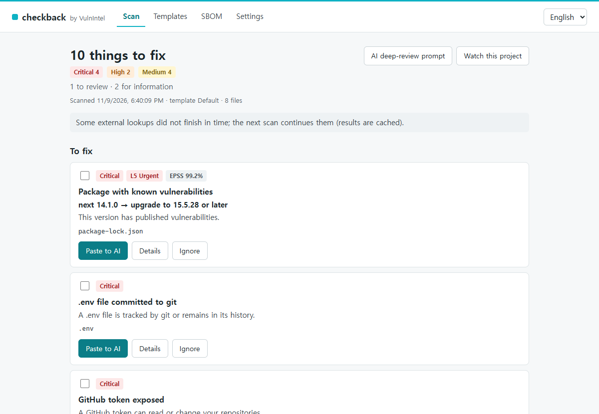
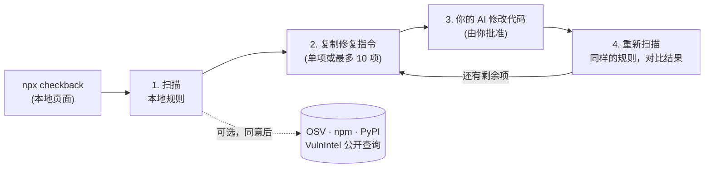
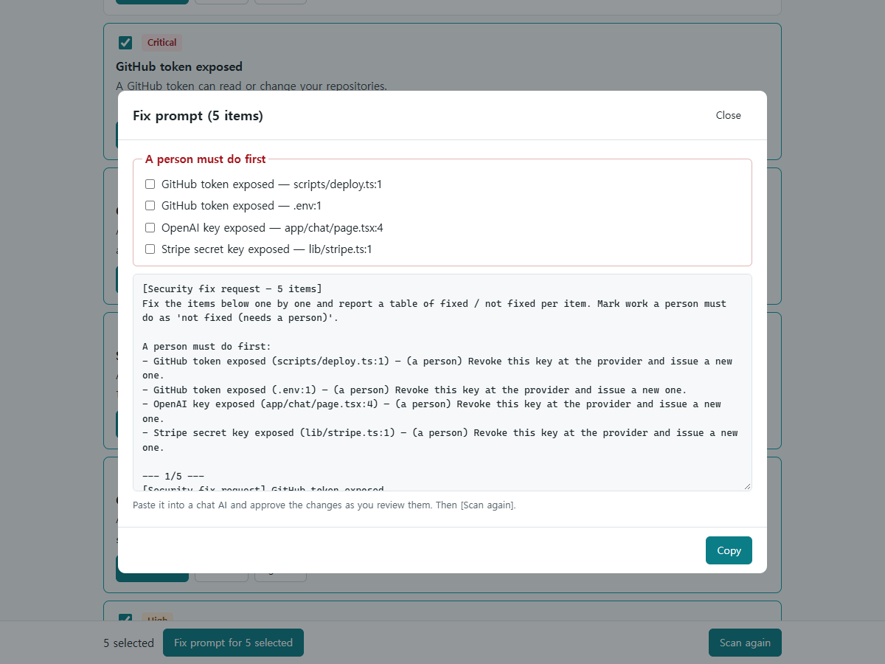
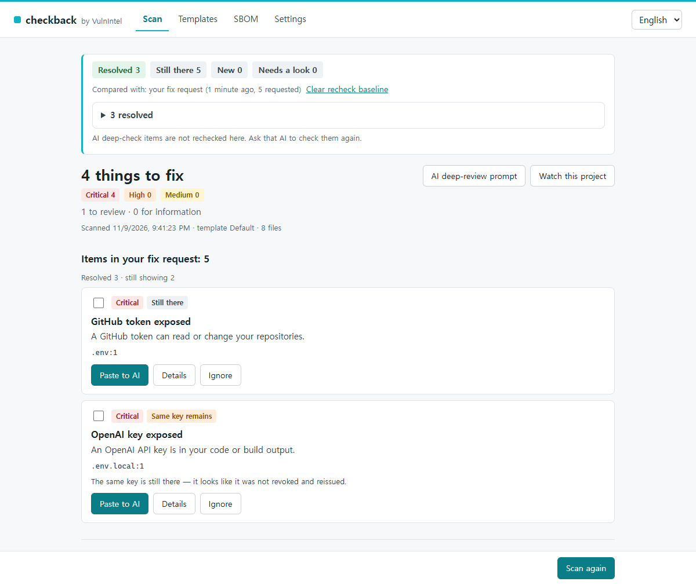

# checkback

[English](https://github.com/vulnintel/checkback/blob/main/README.md) · [한국어](https://github.com/vulnintel/checkback/blob/main/README.ko.md) · 简体中文

**找出 AI 编程工具留下的安全疏漏，把修复交还给你的 AI，然后再检查一遍。**

[](https://github.com/vulnintel/checkback/actions/workflows/ci.yml)
[](https://www.npmjs.com/package/checkback)
[](package.json)
[](LICENSE)

checkback 在你自己的电脑上扫描项目，查找用 Cursor、Claude Code、Lovable、Bolt 等 AI 编程工具构建的应用中常见的安全疏漏：浏览器代码里的密钥、提交进仓库的 `.env`、没有开启 RLS 的 Supabase 表、写着 `if true` 的 Firebase 规则、完全放开的 CORS、生产环境的调试模式，以及有漏洞或被 AI 臆造出来的依赖包。每个发现项都会生成一段通俗易懂的修复指令，粘贴给你正在用的 AI 即可。修复完成后再运行一次：checkback 会复查它的规则所覆盖的项目（密钥、配置和依赖版本），并显示哪些问题还在。

代码不会离开你的电脑，也不需要注册账号。



<sub>演示项目使用的是假密钥。漏洞数据来自 OSV.dev，优先级来自 VulnIntel。</sub>

## 快速开始

在项目目录中运行（需要 Node.js 20.18 或更高版本）：

```sh
npx checkback
```

1. 浏览器会打开一个本地页面。同意外部查询（也可以拒绝：本地规则照常运行）。
2. 点击 **开始扫描**。
3. 勾选要修复的发现项（或使用 **快速选择**：严重、严重+高危、全部），点击 **为所选 n 项生成修复提示词**，复制后粘贴给你的 AI。
4. AI 改完后，点击 **重新扫描**。

页面和终端报告支持 English、한국어 和简体中文。

一次扫描最多等待外部查询 90 秒，然后先显示已有的结果，并注明哪些查询还没返回；下一次扫描会从缓存继续。公开优先级查询（KEV、VPI、EPSS）的速度约为每分钟 50 个漏洞，因此有几百个已知漏洞的项目需要扫描 3 到 4 次，所有优先级标记才会填满。在此之前，这些包沿用 OSV/CVSS 严重程度，并标为“严重程度暂定”，快速选择中的“严重”和“严重+高危”会跳过它们。

依赖检查读取 `package-lock.json`、`pnpm-lock.yaml`、`uv.lock` 和 `requirements*.txt`。只有 `bun.lock` 的项目（Lovable 的默认配置）可以使用其他所有检查，但暂时不检查其依赖。如果 `uv.lock` 和 `requirements*.txt` 在同一目录下，同一版本的包只算一个发现项，并指向 `uv.lock`。

更习惯待在终端或 Claude Code 里？请看 [Claude Code 插件](#claude-code-插件)、[MCP 服务器](#mcp-服务器) 和 [命令行](#命令行)。

## 为什么用 checkback

AI 编程工具擅长写应用，审查代码通常也做得不错，但在重复性的工作上不够可靠：读 git 历史、把精确的包版本逐一对照安全公告、对同一个问题每次都给出同样的答案。Gitleaks 和 osv-scanner 各自擅长自己的领域（密钥、依赖版本），但不读 Supabase 迁移文件，也不读 Firebase 规则。checkback 补的正是中间这一块，它是和你的 AI 一起用的，而不是用来替代 AI。

如果你用 Supabase，也请运行 Supabase 的 Security Advisor：它检查的是线上数据库，checkback 读的是代码和迁移文件。

| | checkback | Gitleaks | osv-scanner | 仅靠 AI 代码审查 |
|---|---|---|---|---|
| 代码和构建产物中的密钥 | 是 | 是 | 否 | 是 |
| 不把公开密钥（Supabase anon、Firebase Web 配置）当作问题 | 是 | 常被标记 | 不适用 | 未测 |
| 仍在 git 历史中的 `.env` 和密钥文件 | 是 | 是 | 否 | 只读工具做不到 |
| Supabase RLS、Firebase 规则、CORS、调试设置 | 是 | 否 | 否 | 是 |
| lock 文件中的漏洞版本 | 是（OSV） | 否 | 是 | 部分；误判了一个版本 |
| 不存在的包名（AI 臆造） | 是 | 否 | 否 | 未测 |
| 授权、IDOR、注入、业务逻辑 | 仅提供给 AI 的检查清单 | 否 | 否 | 是 |
| 本地规则：输入相同，结果相同（外部查询取决于实时数据） | 是 | 是 | 不适用（仅查询） | 否 |
| 每次运行不产生费用 | 是 | 是 | 是 | 否 |
| 为非专业人士编写、可直接粘贴给 AI 的修复指令 | 是 | 否 | 否（`osv-scanner fix` 可以自行升级部分依赖） | 是 |
| 与请求修复时的状态对比复查 | 是 | 重新运行 | 重新运行 | 重新提问 |

测试方法：2026 年 11 月，我们在 5 个公开的、由 AI 构建的仓库上运行了这些工具，每个仓库都固定在某个提交。

- checkback 0.1.0（已发布的包），不使用 VulnIntel 密钥，允许外部查询。
- Gitleaks 8.30.1 和 osv-scanner 2.7.0，使用默认设置。osv-scanner 与 checkback 在同一天重新运行；Gitleaks 的数据来自一周前的第一轮。
- AI 审查：Claude Code 2.1.316，只用只读工具（Read/Grep/Glob，无 shell），使用我们自己的审查提示词，每个仓库运行一次（第一轮）。

我们看到的结果：

- AI 审查覆盖的问题范围最广，其中包括一些属于 checkback 检查类别、但 checkback 目前仍会漏掉的问题，例如硬编码的管理员密码和 Firestore 规则逻辑。它自己说明在 5 个仓库中有 3 个没有查看 git 历史。它把一个有漏洞的依赖版本判断为"已修补"。每次审查用了 24 到 47 轮、87 到 178 秒，花费 $0.50 到 $1.40。
- 同一天运行的 checkback 和 osv-scanner，对 checkback 所读 lock 文件中的漏洞依赖版本，202 个里 202 个结论一致。
- 工作区里有 5 个公开密钥：一个应用中的三个 Supabase anon 密钥，以及另一个应用已提交的构建产物中的一个 Clerk publishable 密钥和一个 PostHog 密钥。checkback 没有把其中任何一个报告为机密，并把 Supabase 密钥标为可以放在浏览器中。Gitleaks 报告了 11 次公开密钥（包括 git 历史中的副本）。唯一真正的机密，即 `.mcp.json` 中的 Supabase access token，两者都报告了。
- 有一个应用提交了只含公开值的 `.env`。checkback 把它列为参考项，而没有让你轮换密钥。
- checkback 报告了一个其他工具都没有发现的问题：流式响应中硬编码的 `Access-Control-Allow-Origin: *`。

样本很小，请把它当作方向参考，而不是基准测试。

## 工作原理



**修复指令** 先列出只有人才能做的事（吊销并重新签发泄露的密钥），然后每个发现项一节，写明 `file:line`、问题是什么以及怎么修。指令里绝不包含密钥值，也绝不会让 AI 安装项目里原本没有的包。



**重新扫描** 会与你复制修复指令的那一刻对比。在下面的演示中，OpenAI 密钥只是被移到了 `.env.local`，并没有吊销，所以 checkback 报告的仍是同一个密钥：

<picture>
  
</picture>

## 能做什么，不做什么

| 能做 | 不做 |
|---|---|
| 在代码、配置和构建产物中查找密钥（OpenAI、Anthropic、Supabase、AWS、Stripe、GitHub、私钥、数据库 URL 等） | 证明你的应用是安全的。通过只说明这些规则都没有命中 |
| 检查 git：被跟踪或仍留在历史中的 `.env` 和密钥文件，以及缺少 `.env` 规则的 `.gitignore` | 检查授权、IDOR、注入或其他应用逻辑。它会为你的 AI 写一份审查清单，但不会复查 AI 的结论 |
| 读取 Supabase 迁移文件（未开启 RLS 的表、恒为真的策略）和 Firebase 规则 | 连接你的 Supabase 或 Firebase 项目或数据库 |
| 标记通配符 CORS、调试模式、公开的 source map | 扫描网站，或通过网络扫描任何东西 |
| 读取 `package-lock.json`、`pnpm-lock.yaml`、`uv.lock` 和 `requirements*.txt`；（经同意后）查询有漏洞、恶意和不存在的包 | 解析 yarn、bun、poetry 或 Pipfile 的 lock 文件（暂不支持，会显示"暂不支持"而不是"没有问题"） |
| 在本地生成 CycloneDX SBOM | 把你的代码上传到任何地方 |
| 修复后复查自己的发现项 | 修改你的代码，或自行运行 AI |

## Claude Code 插件

checkback 自带一个 Claude Code 插件。在 Claude Code 中添加 marketplace 并安装插件：

```text
/plugin marketplace add vulnintel/checkback
/plugin install checkback@vulnintel
```

然后说"帮我做一次安全检查"（或 "run a security check"）。Claude 会调用 checkback 的 `scan` 并列出发现项。如果你需要，它还会用 checkback 的检查清单审查代码，并以"AI 判断"单独报告。当你让它修复时，每次修改都会经过 Claude Code 正常的批准提示。之后它会再次调用 `scan`，按 checkback 给出的结果报告每一项的复查状态。

插件只有三个文件，都在 [`plugin/`](plugin) 中：

| 文件 | 用途 |
|---|---|
| `.claude-plugin/plugin.json` | 插件名称和版本 |
| `skills/checkback/SKILL.md` | Claude 遵循的指令：扫描、可选的 AI 审查、经你批准后修复、重新扫描 |
| `.mcp.json` | 启动 `npx -y checkback@<version> mcp`，版本固定为插件版本，不带密钥 |

没有 hook、二进制文件、agent、命令、权限规则或自动批准设置。marketplace 清单是 [`.claude-plugin/marketplace.json`](.claude-plugin/marketplace.json)。

插件以你的权限运行。添加任何第三方 marketplace（包括这个）之前，请先读一遍其中的文件，只安装来自可信来源的插件。

连接 VulnIntel 密钥、订阅依赖包和忽略发现项都在 `npx checkback` 中完成，而不是在对话里。

如果首次使用时 `/mcp` 显示 checkback 服务器连接失败，说明 npx 还在下载包。在终端里运行一次 `npx -y checkback@<version> --version` 填充 npx 缓存，然后重启 Claude Code。在较慢的机器上，也可以调高 Claude Code 的 MCP 启动超时，例如 `MCP_TIMEOUT=120000`。

## MCP 服务器

任何 MCP 客户端都可以通过 stdio 使用同一个引擎。请固定版本：

```json
{
  "mcpServers": {
    "checkback": {
      "command": "npx",
      "args": ["-y", "checkback@0.1.0", "mcp"]
    }
  }
}
```

不装插件、直接在 Claude Code 中使用：`claude mcp add checkback -- npx -y checkback@0.1.0 mcp`。在原生 Windows 上，部分客户端需要使用 `"command": "cmd"` 和 `"args": ["/c", "npx", "-y", "checkback@0.1.0", "mcp"]`。

服务器扫描它启动时所在的目录（Claude Code 通过 `CLAUDE_PROJECT_DIR` 传入项目目录）。没有任何工具接受路径参数。

| 工具 | 返回 |
|---|---|
| `scan(template?)` | `{findings, checked, compare?, notice?}`。发出修复请求后，`compare`（数量和已解决项）以及每个发现项的 `recheck` 会显示对比结果 |
| `explain(finding_id)` | 该发现项为什么重要、怎么修复 |
| `fix_prompts(finding_ids)` | 最多 10 个发现项的修复指令；同时记录修复请求基准 |
| `ai_check_prompt()` | 供 AI 使用的只读审查清单（授权、IDOR、注入等） |
| `export_sbom()` | 已锁定依赖的 CycloneDX JSON |

MCP 响应中绝不包含密钥值、打码后的值或文件内容，只有密钥类型和 `file:line`。没有用于忽略发现项、给出同意、订阅依赖包或运行 AI 的工具。在同意之前，`scan` 只运行本地规则，它的 `notice` 会说明如何开启外部查询。

切勿把 VulnIntel 密钥写进 MCP 配置文件。请使用 `VULNINTEL_API_KEY` 环境变量或设置页面。

## 命令行

| 命令 | 作用 |
|---|---|
| `checkback` / `checkback gui` | 启动本地页面并打开浏览器 |
| `checkback --no-open` | 同上，但只打印 URL |
| `checkback scan [--lang en\|ko\|zh] [--template file.yaml] [--json\|--text] [--fail-on severity]` | 扫描当前目录。在终端中输出易读的报告（按严重程度汇总，每个发现项附 file:line 和一行说明）。通过管道或在 CI 中输出 JSON。`--json` / `--text` 可强制使用其中一种。绝不打印密钥值或打码后的值 |
| `checkback sbom [--upload-preview]` | 打印已锁定依赖的 CycloneDX JSON SBOM。`--upload-preview` 打印使用 VulnIntel 密钥时会发送的内容（已去除私有包），不上传任何东西；`--upload` 是旧的别名 |
| `checkback mcp` | 通过 stdio 运行 MCP 服务器 |
| `checkback consent` | 在终端中同意外部查询。仅限交互式终端 |
| `checkback ignore [--remove]` | 忽略上次扫描的发现项（需填写原因），或取消忽略。仅限交互式终端 |
| `checkback watch` | 需要 VulnIntel 密钥：订阅已锁定的公开包，出现新漏洞时提醒。仅限交互式终端 |
| `checkback track` | 需要 VulnIntel 密钥：把上次扫描中的 CVE 加入 VulnIntel 处置台账。仅限交互式终端 |

`checkback --help` 列出所有命令和选项；`checkback --version` 打印版本号。

本地页面只绑定 `127.0.0.1`，每次运行都使用新的随机令牌。按 Ctrl+C，或关闭最后一个标签页 30 分钟后，它会停止。

退出码：`0` 完成（无论有无发现项），`1` 达到 `--fail-on` 阈值或命令失败，`2` 未知命令或选项。

### 在 CI 中使用

`scan --fail-on <critical|high|medium|low>` 在存在该严重程度及以上的已确认发现项（"待修复项"）时以 1 退出（`low` = 任意严重程度）。待确认和参考类发现项不会让构建失败。

```yaml
# .github/workflows/checkback.yml
on: [push, pull_request]
jobs:
  checkback:
    runs-on: ubuntu-latest
    steps:
      - uses: actions/checkout@v4
        with:
          fetch-depth: 0 # 让"已提交的 .env / 密钥文件"规则能读到 git 历史
      - uses: actions/setup-node@v4
        with:
          node-version: 22
      - run: npx -y checkback@0.1.0 scan --text --fail-on high
```

CI 只运行本地规则，不做依赖查询：同意只能由人给出（`checkback consent` 需要交互式终端，也可以在本地页面上同意），而全新的 CI runner 上没有保存过的同意记录。报告顶部会说明这一点，`--fail-on` 也会在 stderr 输出依赖检查未运行的警告；退出码只反映实际运行了的检查。如果是浅克隆（shallow clone），报告还会注明 git 历史检查被部分跳过。

设置、同意记录、忽略列表和复查基准都保存在项目之外：Windows 上是 `%APPDATA%\checkback`，macOS 上是 `~/Library/Application Support/checkback`，Linux 上是 `$XDG_DATA_HOME/checkback`（默认 `~/.local/share/checkback`）。

## 规则

默认模板（[`templates/default.yaml`](templates/default.yaml)）是只读的，版本随引擎一起发布。

| 类别 | 规则 | 示例 |
|---|---|---|
| 密钥 | `secret-openai`, `secret-anthropic`, `secret-supabase-service-role`, `secret-supabase-pat`, `secret-aws`, `secret-stripe-live`, `secret-github`, `secret-google-key`, `secret-private-key`, `secret-db-url`, `secret-vulnintel`, `secret-public-env-prefix`, `secret-in-mcp-config` | 浏览器代码或构建产物中的密钥；加了 `NEXT_PUBLIC_` 或 `VITE_` 前缀的机密值 |
| 已提交的文件 | `env-committed`, `key-file-committed`, `gitignore-env-missing` | `.env` 被跟踪或仍在 git 历史中；提交了 `*.pem` |
| 后端规则 | `supabase-rls`, `firebase-rules` | 建表时没有开启 RLS；`allow read, write: if true` |
| CORS | `cors-wildcard`, `cors-credentials-any` | `app.use(cors())`；允许任意来源并携带凭据 |
| 调试 | `debug-django`, `debug-flask`, `debug-fastapi`, `debug-laravel`, `debug-spring`, `debug-env-production` | 生产配置中的 `DEBUG = True` |
| Source map | `sourcemap-next`, `sourcemap-vite`, `sourcemap-in-build` | 生产环境的 source map 可被公开访问 |
| 依赖（外部查询） | `vulnerable-deps`, `hallucinated-package` | 已知漏洞版本（OSV）；恶意包（OpenSSF）；npm 或 PyPI 上不存在的包名，或看起来像热门包拼写错误的包名 |
| AI 检查清单 | 11 个 `ai-*` 项 | 授权、IDOR、注入、服务端校验等。仅作为清单发给你的 AI；checkback 不会执行，也不会复查 |

每个发现项都有严重程度（`critical`、`high`、`medium`）和可信度：**已确认**（计为待修复项）、**待确认**（需要人工查看）或 **参考**（默认折叠）。示例和文档（`.env.example`、README 代码块）归为参考，测试目录归为待确认，占位值（`your-key`、`xxx`、`<…>`、`changeme`）从不报告。被 gitignore、未被跟踪且从未提交过的 `.env.local` 是存放密钥的正常位置，归为参考。

## 复查状态

基准是你复制修复指令（或调用 `fix_prompts`）的那一刻。没有基准时，checkback 与上一次扫描对比。AI 判断不参与对比。

| 状态 | 含义 |
|---|---|
| 已解决 | 该发现项已消失。如果是密钥：还要到服务提供方吊销并重新签发 |
| 仍存在 | 该发现项仍在。如果有漏洞的包升级后的版本仍有漏洞，它会保持为同一张卡片，并附上类似"已从 4.17.20 升级到 4.17.21，但仍有漏洞。请升级到 4.18.0 或更高版本。"的说明。如果 manifest 改了而 lock 文件没变，说明会提示你重新安装，以重新生成 lock 文件 |
| 新增 | 基准中没有的发现项 |
| 同一密钥仍在 | 同一个密钥值仍在某处，例如被移到了 `.env.local`。看起来没有吊销并重新签发 |
| 疑似已移动 | 相同的内容似乎移到了另一个文件 |
| 可信度降低 | 它移到了规则检查较宽松的位置（例如测试目录）；仍保留原来的可信度 |
| 需确认（lock） | lock 文件看起来被手动改过：版本变了却没有新的 integrity 哈希，或出现了 manifest 中没有的顶层条目。请用包管理器重新安装 |
| 未检查 | 这次规则没有运行（已关闭或离线），因此结果未知 |

## 数据去向

checkback 本身不会把任何代码或文件路径发送到任何服务器。你粘贴给 AI 的指令里确实包含 `file:line`（见下表最后一行）。外部查询只在你同意后才运行，并且每一项都可以在设置中关闭。

| 目的地 | 何时 | 发送内容 | 绝不发送 |
|---|---|---|---|
| `api.osv.dev` | 漏洞包和恶意包检查 | 查询范围内包的生态系统、名称和版本 | 代码、文件路径、私有包名 |
| `registry.npmjs.org`、`api.npmjs.org`、`pypi.org` | 不存在包检查 | 查询范围内的包名（包括 lock 中缺失的 manifest 包名和过滤后的 import 名称） | 同上 |
| `api.vulnintelapp.com`（公开查询，无需密钥） | 优先级（KEV、VPI 等级、EPSS）和描述 | 来自 OSV 结果的 CVE/GHSA ID，以及界面语言。你的 IP 和 ID 列表可能留在访问日志中（VulnIntel 的服务器，以及位于它前面的 Cloudflare），而 ID 列表可能透露你在用哪些有漏洞的组件 | 包名和版本、代码、路径 |
| `api.vulnintelapp.com`（使用密钥） | 仅在你添加了 VulnIntel 密钥时 | 本地生成的公开包 CycloneDX SBOM（名称、版本、purl、许可证；不含项目名）；加入处置台账时的 CVE ID 和 `checkback: <package>@<version>` 备注；你选择订阅的包的生态系统和名称（不含版本） | 代码、路径、lock 文件名、私有包 |
| 你的 AI | 你粘贴指令时，或 AI 调用 MCP 工具时 | 指令和 MCP 响应：规则、严重程度、可信度、`file:line`、包、版本、漏洞 ID；`export_sbom` 返回本地 SBOM，其中包含私有包和 lock 文件路径。你的 AI 工具也可能自己读取你的文件，这是你和 AI 服务商之间的事 | 密钥值和打码后的值。这条路径不会向 VulnIntel 发送任何内容 |

来自私有 registry（`.npmrc` 中的 scoped 或默认 registry 改动、`--extra-index-url`）、workspace、本地文件或 git URL 的包不在查询范围内。

使用密钥时，VulnIntel 会把扫描结果和 SBOM 保留 30 天，上传的原始文件保留 35 分钟。订阅的包和处置项会一直保留，直到你在网页上删除。

所有发往 `api.vulnintelapp.com` 的请求，无论是否使用密钥，都会经过 Cloudflare（VulnIntel 的 CDN 和防火墙），Cloudflare 能看到你的 IP 和请求内容。

请求带有 `User-Agent: checkback/<version> (+https://github.com/vulnintel/checkback)`。没有遥测。

## VulnIntel 密钥（可选）

以上所有功能都不需要账号。免费的 [VulnIntel](https://www.vulnintelapp.com) 密钥额外提供两项功能：

- **持续订阅**：你选的包出现新漏洞时收到通知（页面上的 **订阅此项目**，或 `checkback watch`），并可把 CVE 加入网页版处置台账。
- **历史记录**：扫描结果在网页上保留 30 天。

在 <https://www.vulnintelapp.com/en/settings/api-keys?src=checkback> 获取密钥，然后粘贴到设置页面，或设置 `VULNINTEL_API_KEY`（环境变量优先）。在 macOS 和 Linux 上，设置文件以 600 权限写入。密钥只会发送到 `api.vulnintelapp.com`。

免费密钥每月包含 100 次 VulnIntel 查询。用完后，扫描只显示 OSV 结果，直到每月额度重置。

## 模板与忽略

在 **模板** 页面，你可以复制默认模板、开关规则、添加自己的 AI 检查清单语句，并以 YAML 导出或导入模板。导入模板中的文字会标为"外部"，复制前会完整显示。

手写的模板可以添加 `pattern` 规则：

```yaml
schema: 1
id: my-rules
name: My rules
rules:
  - id: internal-admin-token
    name: { en: Internal admin token in code, ko: 내부 관리자 토큰 노출 }
    type: pattern
    severity: high
    files: ['src/**/*.ts']
    match:
      - 'ADMIN_TOKEN\s*=\s*"[A-Za-z0-9]{24,}"'
    description:
      en: An internal admin token is hard-coded.
      ko: 내부 관리자 토큰이 코드에 들어 있습니다.
    fix_prompt:
      en: Remove the token from {file} and read it from a server-side environment variable.
      ko: "{file}에서 토큰을 지우고 서버 환경변수에서 읽게 바꾸세요."
```

```sh
npx checkback scan --template my-rules.yaml
```

模板在加载时会校验：未知字段、指向项目之外的 glob、执行缓慢的正则表达式以及超过 1 MB 的文件都会被拒绝。

忽略发现项（页面上的 **忽略**，或 `checkback ignore`）会把它的指纹、标签（规则标题、包和 `file:line`）以及你填写的原因保存在设置目录中，绝不写进项目。被忽略的发现项在行号变动后、在 MCP 结果和复查中都保持隐藏，直到你在设置中移除。

## 常见问题

**我的代码会离开我的电脑吗？**
不会。唯一会发出去的是 [数据去向](#数据去向) 中列出的包名、版本和漏洞 ID，而且只在你同意后发送。拒绝的话，什么都不会发送。

**能离线使用吗？**
可以。本地规则、SBOM、修复指令和复查都不需要网络。需要查询的规则会标为"未检查（离线）"，而不是报错。我们的发布测试会在禁用网络的容器中运行已安装的包。

**它报告了一个其实没问题的项，怎么办？**
点击 **忽略** 并填写原因，或提交 [误报反馈](https://github.com/vulnintel/checkback/issues/new?template=false_positive.yml)。切勿粘贴真实的值，只描述它的格式。本来就应该公开的密钥（Supabase anon 或 publishable 密钥、Firebase Web 配置、Stripe publishable 密钥）不会被报告为机密。

**扫描结果是干净的，我就安全了吗？**
不一定。干净的结果只表示这些规则都没有命中。checkback 不检查应用逻辑；这部分请用 AI 检查清单，并把它的答案当作 AI 的判断。

**checkback 会修改我的代码或运行 AI 吗？**
不会。它只写指令；用哪个 AI 来执行由你决定，修改也在那边由你批准。

**支持哪些 AI 工具？**
任何能粘贴文本的工具都可以。Claude Code 还可以使用插件，任何 MCP 客户端都可以使用 MCP 服务器。

**为什么需要 git？**
为了找出已提交或仍在历史中的 `.env` 和密钥文件。没有 git 时会跳过这两项检查，并给出说明。

## 开发

```sh
corepack enable          # pnpm 版本取自 package.json
pnpm install
pnpm build               # 引擎 → dist/，网页 → dist/web/
pnpm test                # 单元测试和集成测试，不联网
node dist/cli.js --no-open
```

`pnpm e2e:docker` 用 `npm pack` 打包，在干净的 `node:20-slim`、`node:22-slim` 和 `node:24-slim` 容器中安装 tarball，并检查 CLI、MCP 服务器和本地页面，联网和 `--network none` 各跑一次（[`docker/e2e/`](docker/e2e)）。需要 Docker 和 bash。

`node scripts/live-smoke.mjs` 手动运行真实的 OSV、npm、PyPI 和 VulnIntel 查询；它不属于 `pnpm test`。

提交 pull request 前请先阅读 [CONTRIBUTING.md](CONTRIBUTING.md)。变更记录见 [CHANGELOG.md](CHANGELOG.md)。

## 安全

请私下报告 checkback 中的漏洞，详见 [SECURITY.md](SECURITY.md)。

## 商标

Claude and Claude Code are trademarks of Anthropic, PBC. This project is not affiliated with or endorsed by Anthropic. Other product names are trademarks of their owners and are used only to describe compatibility.

## 许可证

[Apache-2.0](LICENSE)。第三方代码和数据列在 [NOTICE](NOTICE) 中。漏洞数据：[OSV.dev](https://osv.dev)（各来源许可证不同；恶意包：[OpenSSF Malicious Packages](https://github.com/ossf/malicious-packages)）。优先级数据：VulnIntel（KEV：CISA，EPSS：FIRST.org）。

由 [VulnIntel](https://www.vulnintelapp.com) 出品。
